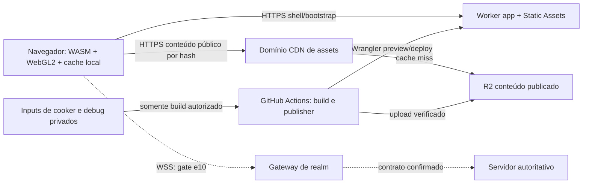

# Cloudflare/Wrangler — topologia e operação v1

Estado: proposta específica para implementação; sem recurso provisionado nesta
entrega. Decisões do operador: Cloudflare+Wrangler e **assets públicos no CDN
no MVP/desenvolvimento**. Inputs/fontes/debug e dados de contas não são assets
públicos. Relaciona e17 WO-01/02/03/04/05 e contratos de e15.

## Topologia mínima e propriedade



| Unidade | Dados/autoridade | Callers | Motivo da fronteira |
| --- | --- | --- | --- |
| Worker app | bootstrap pinado + shell ASSETS; sem gravação de jogo | browser | deploy/versionamento do launcher |
| R2 content + CDN | bytes imutáveis publicados; escreve apenas publisher | browser lê, CI escreve | tamanho/volume/cache independente do shell |
| tooling de release | proveniência, assinatura, catálogo de artefatos | CI confiável | tokens não chegam a PR/runtime |
| gateway futuro | tradução/transporte/sessão e limites e10 | browser WSS | confiança, limites e lifecycle separados |
| server futuro | mundo, combate, persistência autoritativos | gateway | exige prova de compatibilidade/capacidade própria |

Um único Worker agora. Rejeitamos Worker por pacote e proxy Worker para todo asset
público: adicionariam invocações/custo sem necessidade. Não incluir KV, D1, DO ou
Queues até existir acesso/consistência que justifique. Gateway não pertence ao
Worker de CDN/bootstrap. Cloudflare Containers é candidato a pesquisar para
backend Linux/gateway; não está homologado para o servidor/latência deste jogo.
Não prometer que um `.exe` Windows ou o servidor legado roda em Workers.

## Ambientes, bindings e isolamento

| Ambiente | App | Conteúdo | Realm | Tokens |
| --- | --- | --- | --- | --- |
| local | wrangler dev/synthetic | filesystem/R2 local em testes de ferramenta | nenhum por default | nenhum de produção |
| PR | Preview `pr-<n>` | bucket/CDN preview; releases por hash | nulo; staging isolado apenas se aprovado | só publisher preview |
| staging | Worker staging próprio | bucket/CDN staging ou cópia verificada | homologação, nunca produção implícita | Environment staging |
| production MVP | Worker production | bucket/CDN production público | realm aprovado em e10/e11 | Environment production aprovado |

Bindings do app: ASSETS obrigatório; vars APP_ENV, RELEASE_SHA256,
ASSET_BASE_URL e seleção de realm/gateway validadas. Sem R2 binding no app para
servir conteúdo público; URL externa é HTTPS allowlisted, não URL fornecida pelo
usuário. Falta de pin/manifest/config => 503 no bootstrap, nunca fallback para
`latest` ou para o bucket/realm de produção. Diagnostic mantém realm/gateway null.
Previews nativos não herdam configs de produção; declarar `previews.vars`.
Bindings R2/KV/D1 em qualquer serviço futuro precisam apontar recursos separados:
mesmo bucket/id compartilha dados, mesmo em Preview. Service binding de Preview
chama o deployment de produção do Worker de destino: usar um Worker de staging
explicitamente separado se/quando a ligação for necessária. Nenhum binding de
produção por conveniência. Objetos imutáveis podem ser compartilhados entre PRs
no bucket preview, mas cada release é pinada e cleanup não apaga objetos comuns.

## Catálogo público e HTTP

- Bucket de inputs/build-debug privado, sem custom domain público nem r2.dev.
  Bucket público de conteúdo separado, apenas allowlist publicada pelo cooker.
- Domínio próprio ligado a R2 para CDN; r2.dev desligado. Habilitar regras de
  cache para conteúdo binário/JSON, testar HIT/MISS e negative caching; não presumir
  que toda extensão recebe cache automaticamente. Não inferir SHA a partir de ETag.
- Chunks `objects/sha256/*`: identity/no-transform, octet-stream e TTL 1 ano
  immutable. Runtime WASM: application/wasm; JS glue: text/javascript. Servir
  compressão HTTP de WASM/JS com Vary apropriado e testar bytes decodificados/hash;
  não etiquetar arquivo cru como gzip/br. Não aplicar transformação a chunks.
- Manifests imutáveis por hash: application/json e immutable; HTML revalida;
  `/bootstrap.json` no-store; ausência de objetos não deve ficar cacheada por longo
  prazo. Registrar Cache Rules e metadados como configuração revisável.
- CORS GET/HEAD/OPTIONS para origens do app. Como assets são públicos e não usam
  cookies, ACAO `*` é permitido nesse domínio; sem Access-Control-Allow-Credentials.
  Expor Content-Length, Content-Range, Accept-Ranges, ETag. CORS não é autorização.
- CSP do app enumera domínios JS/assets/WSS aprovados; habilitar execução WASM com
  a diretiva mínima compatível, sem liberar eval geral. Worker responses recebem
  seus próprios headers; `_headers` de Static Assets não cobre bootstrap/gateway.
- Sem pthreads inicialmente. Quando houver variante threaded, validar COOP/COEP
  na página e CORS/CORP de **todos** os recursos, inclusive CDN e iframes/autenticação.
  Não ativar isolamento por flags antes de revisar compatibilidade e consumo.

## Configuração proposta (exemplo documental, não implantável ainda)

`infra/cloudflare/app/wrangler.jsonc`, gerado a partir de configuração revisada e
pin de release validado; caminhos/nomes/domínios reais são tarefa CF-01/CF-18.
O diretório abaixo contém apenas shell permitido, nunca raiz do repo.

```jsonc
{
  "$schema": "node_modules/wrangler/config-schema.json",
  "name": "pw-web-app",
  "main": "src/index.ts",
  "compatibility_date": "2026-10-25",
  "workers_dev": false,
  "preview_urls": true,
  "assets": {
    "directory": "../../../artifacts/release-candidate/public-shell",
    "binding": "ASSETS",
    "run_worker_first": ["/bootstrap.json", "/healthz"]
  },
  "vars": {
    "APP_ENV": "production",
    "RELEASE_SHA256": "GENERATED_FROM_VERIFIED_MANIFEST",
    "ASSET_BASE_URL": "https://assets.example.invalid"
  },
  "previews": {
    "vars": {
      "APP_ENV": "preview",
      "RELEASE_SHA256": "GENERATED_FROM_PREVIEW_MANIFEST",
      "ASSET_BASE_URL": "https://assets-preview.example.invalid"
    }
  }
}
```

`preview_urls:true` habilita as URLs workers.dev de teste conforme a versão
Wrangler homologada; não confundir URL com isolamento. Usar o comando Preview e
seu bloco de recursos, nunca Version URL de produção como substituto. A
configuração de domínios/flags será comprovada no sandbox de CF-19.
Os placeholders são propositalmente inválidos: publisher
nega sha/domínio inválido antes de deploy. JSONC schema path deve ser ajustado
à localização final do package/lockfile; validar com Wrangler pinado antes do PR
executável. Não habilitar rotas de produção sem domínio/zone configurados.

## CLI e automação previstos

Wrangler 4.152.0 consultado no registry e documentação em 2026-10-25; fixar no
package-lock em CF-02 antes de executar. Comandos abaixo são futuros, não foram
rodados nesta entrega e dependem dos arquivos/recurso real:

```bash
npm ci
npx --no-install wrangler dev --config infra/cloudflare/app/wrangler.jsonc
npx --no-install wrangler deploy --dry-run --config infra/cloudflare/app/wrangler.jsonc
npx --no-install wrangler preview --name pr-123 --ignore-base-config --json --config infra/cloudflare/app/wrangler.jsonc
npx --no-install wrangler deploy --config infra/cloudflare/app/wrangler.jsonc
npx --no-install wrangler preview delete --name pr-123 --skip-confirmation --config infra/cloudflare/app/wrangler.jsonc
```

Preview command é o atual `wrangler preview`, não `versions upload --preview-alias`
que apenas cria Version URL. Staging usa configuração/Worker separado, não alias
com produção ligada. `--ignore-base-config` evita segredos configurados na base de
Preview serem herdados por acidente; config explícita permanece obrigatória.
Dry-run prova empacotamento, não domínio/binding/cache remoto. Homologar `preview`
em sandbox primeiro; se o recurso não estiver disponível na conta, registrar
BLOCKED e revisar alternativa Worker por PR, sem deploy improvisado/temporário.

Wrangler administra Workers, previews e buckets/configuração disponível. Upload
em massa/dedupe/metadata/retry usa API S3 R2 com ferramenta de release, porque um
loop de upload CLI por arquivo não é um planejador de conteúdo. O uploader também
é pinado e testado; token S3 separado, nunca embutido no JS. Não prometer que
Wrangler sozinho compila C++, descobre dependências ou transforma os assets.

## Segurança, operação e custo

GitHub secrets previstos: CLOUDFLARE_API_TOKEN e R2 credenciais por ambiente;
account ID e nomes de recursos em variables revisáveis, não inventar valores.
Token de preview não administra produção; restrição efetiva de recurso/conta deve
ser demonstrada por negativo. API tokens de conta podem ter escopo maior do que
uma app; se a permissão não isolar suficiente, usar conta de sandbox separada.
Chave de assinatura somente no Environment protegido; Access de admin/gameplay
não é substituído por assets públicos. Sem login de jogador em logs/artefatos.

Publisher usa workflow confiável, artifact SHA/run_id aprovado, schemas/allowlist,
concurrency por ambiente e comparação de versão esperada. Não executar npm hooks
ou código do PR no processo com token. Wrangler config vem do publisher confiável,
com apenas pins/URLs allowlisted interpolados; negar build.command, argumentos,
plugins e caminhos recebidos do PR. Validar arquivos/symlinks/tamanho do artefato
antes de extrair/publicar; rejeitar traversal e archive bombs. Remote smoke faz GET efetivo e checa corpo,
MIME, cache, CORS, release pin e assinatura. Realm/gateway inacessível não muda o
bootstrap para produção. Publicidade de assets é assumida no MVP: hashes não são
senha e paths difíceis de adivinhar não protegem nada.

Medir: invocações do app, requests/HIT CDN, leituras R2, bytes totais/até entry,
número médio de objetos por jogador e retenção de previews. Uma cidade movimentada
é cenário de hot key para CDN; muitos cosméticos únicos são cenário de baixa taxa
de hit. Fazer carga com miss/hit, distribuição enviesada e downloads cancelados.
Custo só será estimado com quantidade de jogadores simultâneos e conteúdo real.

Reversão: contrato de [release](contracts/release-manifest.md); não apagar versões
anteriores nem dados R2 ao reverter código. Pós-MVP downloads autenticados exigem
nova fronteira/gateway, autorização antes de shared cache, revogação, threat model
e novos testes; não basta mudar Cache-Control ou esconder o bucket.
