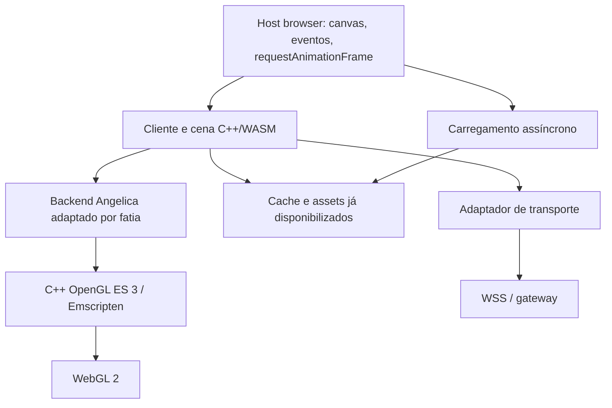

# Método de port da Angelica — contrato e execução por Grok/GLM

## Objetivo e estado real

O produto desejado é um cliente Perfect World executado localmente no navegador:
C++/WASM, renderização WebGL 2, assets carregados sob demanda e protocolo conectado
ao servidor. A Angelica já é uma engine; o trabalho é **portar suas fronteiras de
plataforma**, preservando o comportamento comprovado dos sistemas do jogo.

A [POC-001](POC-ANGELICA.md) comprovou um componente original em WASM e sua saída
numérica alimentando um renderer procedural. Ainda não existe renderer Angelica
portado, cliente Windows reconstruído, asset validado ou sessão de jogo no browser.

Este documento detalha o recorte técnico dos épicos e02, e03, e04, e05 e e06.
Não marca workorders antigos como concluídos nem habilita o scheduler. O uso de
código/assets está autorizado no escopo de `docs/LEGAL.md` (2026-10-25);
referências congeladas e contratos de servidor continuam em vigor.

## Escolha que economiza trabalho

**Portar uma fatia funcional por vez, mantendo um caminho de comparação nativo.**
O primeiro caminho gráfico é uma malha sintética indexada, sem iluminação/textura.
Não começar por `ElementClient::WinMain`, cuja inicialização arrasta UI, dados,
áudio, autenticação, SDKs e renderer antes de oferecer uma imagem comparável.

Três abordagens foram consideradas na [ADR-0004](DECISIONS/ADR-0004-incremental-port-method.md):

| Abordagem | Problema / decisão |
| --- | --- |
| Emular Windows e DirectX por inteiro | API e semântica grandes demais; não adotar como estratégia geral |
| Reescrever cliente, cena e gameplay | Reabre regras já existentes; não adotar como ponto de partida |
| Adaptar fronteiras Angelica por fatia | Escolhida: reaproveita lógica e limita o que precisa de equivalência |

Não basta trocar uma classe: a inspeção lexical encontrou `GetD3DDevice()` em
19 arquivos de `Angelica3D/Source` (104 ocorrências), 6 do cliente (46), 4 de
`Common/GfxCommon` (15) e 3 de `Common/AUInterface2` (4). Esses números excluem a
cópia `Angelica3D/Nova pasta`, mas não são um call graph nem contagem de chamadas
ativas por configuração. Cada fatia deve fechar os acessos diretos que usa.

Pontos iniciais de inspeção:

| Responsabilidade | Evidência na referência `client-153` |
| --- | --- |
| Criar dispositivo | `Angelica2/Angelica3D/Source/A3DEngine.cpp`, `Direct3DCreate8` |
| Estados e draw | `Angelica2/Angelica3D/Header/A3DDevice.h`, `DrawIndexedPrimitive`, `GetD3DDevice` |
| Buffers e binding | `Angelica2/Angelica3D/Source/A3DStream.cpp`, `CreateVertexBuffer`, `SetStreamSource`, `SetIndices` |
| Janela e loop | `Element/CElementClient/ElementClient.cpp`, `wWinMain`; `EC_Game.cpp`, `Run`, `OnceRun` |
| Arquivos/pacotes | `Angelica2/AngelicaFile/Source/AFilePackGame.cpp`, `AFilePackBase.cpp` |
| Transporte | `Element/CElementClient/Network/IOLib/gnactiveio.h`, `gnpollio.h` e `gnstatic.cpp` |
| ABI de base | `Angelica2/AngelicaCommon/Header/ABaseDef.h`, `DWORD`/`LONG` definidos com `long` |

## Fronteiras e propriedade



`pw-web` possui os novos contratos de plataforma, os testes e o backend browser.
As referências possuem os contratos legados que precisam ser medidos; não se
reescrevem suas definições silenciosamente. O servidor possui o protocolo de
rede e suas regras autoritativas; só se integra contra contrato confirmado.

Para o backend integrado, usar C++/OpenGL ES 3 e a ligação WebGL2 do Emscripten.
Isso evita escrever manualmente uma ponte JS para cada método da engine.
O renderer JS da POC-001 é apenas seu instrumento de visualização.
Não criar ainda um protocolo próprio de comandos gráficos ou um tradutor geral
de bytecode shader D3D. Adicionar batching/cache somente diante de medição.

### Migrações por domínio

| Domínio | Método | Teste que libera o próximo passo |
| --- | --- | --- |
| Tipos e matemática | Tipos de tamanho fixo na nova fronteira; converter explicitamente formatos legados | Valores exatos/fixtures nativo e WASM, incluindo limites de 32 bits |
| Render | Adaptar o subconjunto de `A3DDevice`/`A3DStream` usado pela fatia; remover seus escapes D3D desse caminho | Mesh sintética, transformações, profundidade e imagem de referência |
| Fixed function | Shaders GLSL explícitos para cada combinação usada pela fatia | Teste por combinação de cor, textura, blend e alpha test; unsupported é erro |
| Loop/input | Host fornece delta monotônico e estado de input; C++ faz um tick limitado e retorna | Tab oculta, delta grande e perda de foco sem busy loop ou tecla presa |
| Assets | Fetch/cache assíncrono antes de ativar a cena; parser lê bytes já disponíveis | Pacote sintético válido, truncado, offsets fora do limite e cancelamento |
| Áudio | Adaptador para a capacidade necessária, inicializado após gesto do usuário | Falta de permissão/gesto e descarte explícito de recursos |
| Rede | Preservar framing confirmado, trocar transporte por WSS via gateway | Golden bytes do realm escolhido; reconexão e backpressure definidos antes de implementar |
| Threads | Primeiro uma fatia sem threads; só portar concorrência quando ela for necessária | Teste de estados antes de SharedArrayBuffer/Workers e configuração COOP/COEP |

As linhas de áudio/rede/threads são direção arquitetural, **não contratos prontos
para codificar**. O executor só implementa operações com spec fechada.

## Contrato R0 — primeira malha indexada

A fonte canônica foi extraída para
[contracts/render-r0.md](../.agents/epics/e06-render-webgl2-v1/contracts/render-r0.md).
Esse arquivo contém a API C++17, layout, matrizes, ARGB, limites, erros, estados e
fixtures. Leia-o antes de executar P1/P2; não duplique a definição em outro épico.

## Ordem de execução e pacotes de trabalho

As tarefas abaixo operam no escopo da autorização de `docs/LEGAL.md` (2026-10-25);
redistribuição fora desse escopo permanece proibida. Tarefas independentes
de fontes proprietárias podem avançar enquanto se prepara o laboratório Windows.
Não esperar por login para testar matemática/render próprios; não declarar paridade
com o cliente antes da baseline nativa original.

| ID / dono | Entradas e escrita permitida | Passos e saída verificável | Negativo / dependência |
| --- | --- | --- | --- |
| P0 / executor | `tests/probes/`, `scripts/probe-angelica.sh`, docs | Reproduzir POC-001; preservar manifesto e resultado local | Divergência rejeitada. **Executada nesta sessão** |
| P1 / executor | R0; novos `engine/render/clip.h`, `clip.cpp`, `tests/render_clip.cpp`, `scripts/test-render-clip.sh` | Implementar somente tipos, validação e transformação/cor de R0; nativo e WASM com mesmas fixtures | NaN/índice fora do range; não inclui GL nem referência. **PASS: 14 grupos no nativo e WASM/Node** |
| P2 / executor | P1 e R0; novos `engine/platform/web/render_probe.cpp`, `tests/probes/render.html`, `scripts/build-render-probe.sh` | Inicializar GLES3/WebGL2; desenhar fixtures 6/7; ler pixels; lifecycle R0 | Viewport zero, feature não suportada, perda de contexto; depende de P1. **Harness de pixel/lifecycle preparado; backend/execução pendentes** |
| N1 / pesquisa em laboratório | `.sln`/`.vcproj`, SDKs, `docs/evidence/native-client-build.md`; checkout isolado permitido | Fixar Release Win32; inventariar dependências; compilar libs e cliente em diretório limpo; registrar primeiro erro real | Não usar `.obj`/`.pch` carregados do upstream. **Bloqueada no ambiente atual: VS/SDKs** |
| A1 / pesquisa | P2, N1; `docs/evidence/first-draw-closure.md` | Identificar a menor chamada real Angelica até buffers/draw; listar includes, símbolos, libs e escapes D3D; escolher configuração coerente | Se closure arrasta UI/rede, reduzir entrada; não criar stubs. **Pesquisa executável; integração depende dos gates** |
| A2 / executor | A1 e autorização de integração (`docs/LEGAL.md`); área de port aprovada, nunca `references/` | Adaptar apenas a closure de um draw original para R0; comparar com baseline nativa | Mesmo input deve produzir mesmos pontos/cores/profundidade. **Não pronta: closure pendente** |
| A3 / arquitetura + executor | A2; contrato seguinte ainda a escrever | Acrescentar uma textura RGBA sintética, sampler e alpha; depois um formato/malha autorizado e animação | Não inventar formato ECM/SKI/BON. **Não pronta: contrato e fixtures pendentes** |
| G1 / arquitetura + executor | Cena mínima e realm definido | Uma sequência login → personagem → mundo, contratos reais e captura autorizada | Não presumir compatibilidade 1.5.3. **Não pronta: baseline/protocolo/servidor** |

**Comandos existentes de P0:** `node --test tests/probes/compare.test.mjs`,
`./scripts/probe-angelica.sh` e execução do autoteste browser descrito na POC.

**Comandos a criar em P1:** `./scripts/test-render-clip.sh` compila e executa
`tests/render_clip.cpp` com C++17 e `-Wall -Wextra -Werror -pedantic`, depois a mesma
suíte com `em++` e Node. Ausência de compilador/Node é erro, não sucesso por skip.
Deve exigir a contagem esperada de fixtures e sair !=0 no primeiro resultado incorreto.

**Comandos a criar em P2:** `./scripts/build-render-probe.sh` usa
`-sMIN_WEBGL_VERSION=2 -sMAX_WEBGL_VERSION=2`, gera em `artifacts/render-probe/`
e imprime a URL local. A página executa as fixtures, expõe relatório JSON no DOM
e só passa com readPixels confirmado. O executor deve abrir/testar o browser,
capturar o relatório e executar o teste negativo; apenas build não conclui P2.

N1 não tem um comando Windows universal antes da matriz SDK/configuração existir.
O pesquisador deve registrar a linha real de `vcbuild`/MSBuild usada no laboratório,
versões, ordem de projetos e saída. Ausência de SDK é BLOCKED, não licença para
instalar ferramentas de origem desconhecida ou substituir bibliotecas aleatoriamente.

## Pacote autocontido para o próximo executor — P1

Copiar este bloco para Grok ou GLM no mecanismo já configurado. Não requer o histórico da conversa.

```text
Tarefa P1: contrato R0 de matemática/validação para o futuro backend Angelica WebGL2.
Leia AGENTS.md, docs/LEGAL.md, docs/ANGELICA-PORTING-METHOD.md (contrato R0 e P1)
e .agents/epics/e06-render-webgl2-v1/contracts/render-r0.md (API e fixtures),
e docs/POC-ANGELICA.md (diferença de ABI). Não explore o restante de references.

Escrita: engine/render/clip.h, engine/render/clip.cpp, tests/render_clip.cpp,
scripts/test-render-clip.sh e atualização factual do resultado de P1 na documentação.
Preserve alterações existentes de outros agentes. Não altere scripts/dev.sh,
workflows, catálogo, contratos de rede ou referências. Não commit/push automaticamente.

Entregue tipos VertexPC/Matrix4, validação dos inputs R0 e transformação/cor puras.
Use std::uint32_t/std::uint16_t; não reproduza unsigned long como DWORD.
Não implemente renderer, emulação Win32, memória compartilhada, bibliotecas de math
ou abstrações para funcionalidades futuras. Inclua static_assert de layout.

Escreva primeiro as fixtures numéricas/invalid-input de R0 em testes; demonstre RED
por comportamento ausente. Implemente o mínimo, rode GREEN nativo e WASM/Node.
Não basta testar contra a própria fórmula: os valores esperados estão na spec.
Crie o script test-render-clip.sh com ambos os alvos e falha explícita por ferramenta
ausente. Execute ./scripts/verify.sh ao final, sem enfraquecer testes existentes.

Reporte arquivos, comandos, contagem de casos, diferenças de ABI e limitações.
Se precisar decidir convenção de matriz/cor/índice, releia R0: não invente outra.
Se encontrar contradição real, pare apenas a parte dependente e descreva um único
contraexemplo mínimo. Não expanda para P2.
```

## Método operacional para modelos executores

1. **Arquiteto prepara uma tarefa fechada.** Entrada, saída, arquivos, semântica,
   fixtures e condições de erro. Chamar modelo de arquitetura novamente só para
   uma decisão que mude contrato, closure, versão ou resultado esperado.
2. **Um executor implementa uma tarefa.** Pode ser Grok ou GLM; o contrato não
   depende da inteligência presumida do modelo. Ler somente os arquivos do pacote
   e suas dependências diretas; usar `rg` antes de abrir arquivos grandes.
3. **Testes constituem o árbitro.** RED observado, implementação mínima, GREEN;
   depois build/execução nativa e WASM. Provas gráficas precisam de pixel; protocolo
   precisa de bytes acordados; screenshot ou “compilou” não substituem esses testes.
4. **Outro passe revisa diff e evidência.** Pode ser realizado pelo outro modelo,
   com a spec e os logs exatos, sem reexplorar todo o repositório. Conferir semântica,
   código desativado, retorno falso de sucesso, limites e alterações fora do escopo.
5. **Duas tentativas sem progresso no mesmo erro: diagnosticar.** Registrar menor
   reprodução, hipótese refutada e dependência faltante. Não acumular typedefs,
   macros, flags de compatibilidade ou stubs até a compilação aparentar sucesso.
6. **Atualizar o estado e parar no limite da tarefa.** Evidência local em `artifacts/`;
   conclusão sanitizada em docs; diff pronto para revisão. Não promover dependências
   ou hipóteses a PASS por inferência.

Registro mínimo por entrega:

```json
{
  "task": "P1",
  "status": "PASS | FAIL | BLOCKED",
  "source_commit": "hash real da base usada",
  "commands": ["comandos realmente executados"],
  "assertions_passed": 0,
  "assertions_failed": 0,
  "artifacts": ["caminhos locais de logs/resultados"],
  "limitations": ["o que ainda não foi comprovado"]
}
```

Esse JSON é um **modelo de relatório humano**, não um schema do scheduler existente.
`status` deve conter um único valor; contagens devem ser reais. Usar FAIL para teste
executado que falha; BLOCKED para pré-condição ausente; zero casos nunca é PASS.

Grok Build já é o executor documentado em `GROK_BUILD.md`. Não presumir que essa
CLI ou o workflow atual roteia para GLM: integração desse provider é tarefa separada.
Os prompts acima são portáveis. Não configurar provedores, segredos ou automações
externas para cumprir uma tarefa de engine.

## Como manter a velocidade sem acumular dívida

- Preservar uma configuração única de referência por experimento; não misturar
  o renderer D3D8 de 1.5.3 com headers/libs D3D9 de 1.5.2 para silenciar erros.
- Reusar ferramentas oficiais e testes existentes. Não introduzir engine auxiliar,
  transpiler de shaders, camada universal de SO ou dependência de UI na primeira fatia.
- Validar o formato real antes de escrever parser. Extrair dependências pelo build
  e compilador quando disponíveis; busca lexical serve para triagem, não conclusão.
- Manter estado e lifetimes explícitos. Evitar alocações JS por draw; usar o binding
  GLES3/Emscripten antes de inventar uma ponte customizada ou serialização JSON.
- Não perseguir FPS antes de desenhar corretamente. Depois medir draw calls,
  uploads/frame, CPU/GPU, memória e bytes de assets com cenário reproduzível.
- Um resultado ruim é informação: corrigir a spec ou reduzir a fatia, não esconder
  o erro e não permitir que o executor escolha silenciosamente outra arquitetura.

## Revisão de prontidão

Primeiro passe encontrou: interfaces dos épicos sem semântica suficiente; falsa
suposição de isolamento em A3DDevice; ausência de prova de ABI; risco de confundir
compilar um componente com compilar o cliente. Este método adiciona R0, inventário
dos escapes, distinção nativo/wasm32 e estados de prontidão por tarefa.

Segundo passe: cenários matriz transposta duas vezes, ARGB reinterpretado como RGBA,
índice inválido, context loss e fonte/middleware ausente possuem comportamento ou
bloqueio explícito. P1 está pronta; P2 tem contrato, mas depende da entrega P1.
A2/A3/G1 não estão liberadas para implementação. POC-001 continua sendo a prova original em WASM; P1 passou no nativo e em WASM/Node. Ver [evidência R0](evidence/render-r0.md). Não há aprovação de fidelidade visual do cliente original.

Referências técnicas oficiais: [OpenGL/WebGL no Emscripten](https://emscripten.org/docs/porting/multimedia_and_graphics/OpenGL-support.html)
e [loop e ambiente de execução](https://emscripten.org/docs/porting/emscripten-runtime-environment.html).
